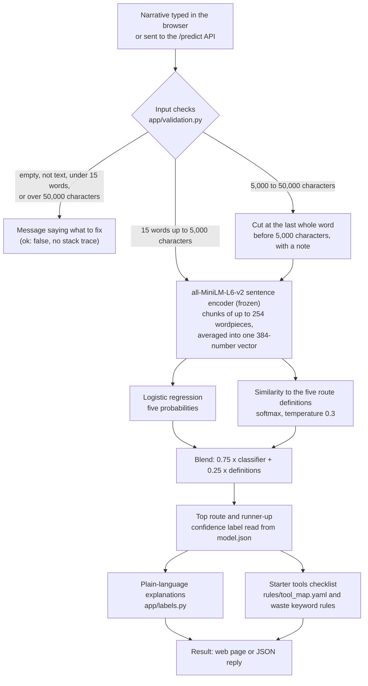

# DMAIC Planner

A web app that reads a short description of a problem at work and suggests which of five
process-improvement routes fits it, with a probability for each route. Team project for
ARI 410/510, University of Michigan-Flint, Fall 2026.

| Everything in one place | |
|---|---|
| **Live app** | https://dmaic-planner-466247443045.us-central1.run.app (available from Tue Dec 8, 2026, 1:30 PM EST until at least Thu Dec 10, 4:00 PM EST) |
| **Code** | <https://github.com/jeraddunne/dmaic-planner> (this repository) |
| **Dataset card** | [`docs/dataset_card.md`](docs/dataset_card.md): sources, annotation, agreement, splits, full leaderboard |
| **Model card** | [`docs/model_card.md`](docs/model_card.md); the model itself is [`models/phase3/c2/`](models/phase3/c2/) |
| **Model choice** | [`docs/model_choice.md`](docs/model_choice.md): leaderboard, candidate comparison, decision |
| **Where the models fail** | [`docs/mistake_patterns.md`](docs/mistake_patterns.md) |
| **Kaggle competition** | <https://www.kaggle.com/competitions/dmaic-process-improvement-classification> |
| **Licenses** | [`LICENSE.md`](LICENSE.md) (which license covers what), [`LICENSE-CODE.txt`](LICENSE-CODE.txt) (MIT), [`LICENSE-DATA.txt`](LICENSE-DATA.txt) (CC BY-SA 4.0) |
| **App and deployment details** | [`app/README.md`](app/README.md), [`deploy/README.md`](deploy/README.md) |
| **Dataset** | [`data/train.csv`](data/train.csv) (40 items) and [`data/test.csv`](data/test.csv) (20 items), CC BY-SA 4.0 |
| **Full project history** | Kept in a private course repository: the earlier phases (data collection, annotation, the Kaggle competition, team tooling) and every commit. Available to the ARI 410/510 instructor on request. |

> **Content note.** The app gives decision support, not decisions. The narratives it learned from
> include medical errors and patient harm, angry consumer complaints about money and debt, and
> workplace conflict (see the [dataset card's content warning](docs/dataset_card.md)). The
> app itself only returns route names, probabilities and fixed explanations. Do not paste names,
> patient details, classified material or other sensitive information: describe the process, not
> the people.

**Contents:** [Introduction](#introduction) · [Usage](#usage) · [Documentation](#documentation) ·
[Contributions](#contributions) · [Limitations](#limitations) · [License](#license) ·
[Citation](#citation)

## Introduction

When a problem reaches an organization's continuous-improvement team, someone has to decide how
to handle it before any work starts. There are five common answers:

| Route | In plain English | Typical effort |
|---|---|---|
| **Just Do It** | Somebody just go fix it. The narrative says what is wrong and what would fix it, and the fix is small. | Hours to a couple of days |
| **Kaizen Event** | Get the right people in a room for a few days. A flow problem (work waiting, hand-offs, duplicated effort, too many approvals) whose rough cause is already understood. | A 2 to 5 day workshop, about two weeks of preparation, a few weeks of follow-up |
| **DMAIC** | Measure before you fix. An existing process gives bad results and nobody knows why. The letters stand for Define, Measure, Analyze, Improve, Control. | About four months (commonly three to six) |
| **DMADV** | Design something that does not exist yet: there is no process today, or the current one could never meet a new requirement. Define, Measure, Analyze, Design, Verify. | About five months or longer |
| **Not a CPI project** | Not a continuous process improvement (CPI) problem at all: really a request for money, staff, a policy decision or a purchase. It goes to a manager or budget owner. | A management decision |

The descriptions and durations are the ones the app shows ([`app/labels.py`](app/labels.py)),
taken from the project's [annotation guidelines](docs/annotation_guidelines.md).

**Why the choice matters.** A wrong call is expensive in both directions. A small fix run as a
months-long DMAIC project ties up a trained lead and a team for a quarter. A problem whose cause
nobody understands, run as a three-day workshop, fails in front of everyone and makes the next
improvement effort harder to sell. In most organizations this judgment sits with a few trained
practitioners, and even they apply it inconsistently. Real problem reports make it harder: they
hedge, mix several problems together and leave the deciding facts (is the cause known? does a
process exist? is this really a budget request?) unstated.

**What the app does.** You paste a description of one problem, at least 15 words. The app returns
a probability for each of the five routes, names the top two, explains both in plain language,
and lists starter tools for the top route. Other programs can get the same result from its API.

**What it learned from.** 60 real problem descriptions from public sources (consumer complaints
to the CFPB, findings from federal GAO audits, IT help-desk tickets, workplace and project
management questions from Stack Exchange, and team-written summaries of patient-safety cases),
each labeled with a route by students following written guidelines. The model is small and runs
on an ordinary CPU with no paid service behind it.

**How far to trust it.** Not far, and the app says so on every answer. In cross-validation the
model's top route was right about 35% of the time, and the right route was among its top two
about 63% of the time (a random ordering would put it there 40% of the time). The people who
labeled the data also disagreed with each other often. Treat the top two routes as a short list
for a person to decide from, never as the decision.

**What changed since the proposal.** The proposal also planned to tag Lean wastes,
take seven structured intake answers as input and draft a project charter, in a Streamlit app.
The system built in Phase 3 predicts the route from the narrative alone. The tools checklist
comes from the project's rule tables, not from the model. The app is built with Gradio and runs
on Google Cloud Run.

## Usage

### Use the live app

1. Open https://dmaic-planner-466247443045.us-central1.run.app.
2. Paste a description of one process problem into the box: what happens, where, how often, what
   it costs and whether anyone knows why. Or click one of the five examples under the box (they
   were written for this demo and are not from the dataset).
3. Click **Recommend a route**.

The result shows the top route and its probability, the confidence label ("Low confidence:
compare the top two routes"), the probability of all five routes, a plain-language explanation
of the top two routes, and a starter tools checklist. The footer shows the model version and how
long the server took. [How to read the confidence](#how-to-read-the-confidence) explains the
numbers.

The app scales to zero when nobody is using it, so the first visit after a quiet spell waits
while a container starts and loads the model (about 10 seconds in a local Docker test; see
[Speed](#speed)).

Text under 15 words, empty input or text over 50,000 characters gets a message saying what to
fix. Text between 5,000 and 50,000 characters is cut to its first 5,000 characters, with a note.
See [Input checks](#input-checks).

### Run it on your own computer

You need either Docker or Python 3.12. Get the code first:

```bash
git clone https://github.com/jeraddunne/dmaic-planner.git
cd dmaic-planner
```

**With Docker** (nothing else to install):

```bash
docker build -t dmaic-planner .
docker run --rm -p 7860:7860 dmaic-planner
```

Then open <http://localhost:7860>. The first build takes several minutes and makes an image of
about 2.5 GB, mostly CPU-only PyTorch. The sentence encoder is built into the image, so the
container never downloads anything when it starts.

**With Python 3.12**, from the repository root:

```bash
python -m pip install -r app/requirements.txt
python -m app.main
```

Then open <http://127.0.0.1:7860>. The first run downloads the sentence encoder (about 90 MB) from
Hugging Face. Two notes:

- On Linux without a GPU, install CPU-only PyTorch first, or pip downloads the much larger CUDA
  build: `python -m pip install --index-url https://download.pytorch.org/whl/cpu torch==2.15.0`.
  On Windows and macOS the default PyTorch package is already CPU-only.
- On Windows, clone to a short path such as `C:\dev\`; a deeply nested folder can hit the
  260-character path limit while scikit-learn installs.

Settings such as the port and the number of CPU threads are environment variables, so no code
changes are needed. They are listed in [`app/README.md`](app/README.md#configuration).

### Call the API

The app has one API endpoint, `/predict`. It takes the narrative as a string and returns one JSON
object. **Use via API** at the bottom of the app page shows the same information.

Python, with `pip install gradio_client==2.7.2`:

```python
from gradio_client import Client

client = Client("https://dmaic-planner-466247443045.us-central1.run.app")  # or http://127.0.0.1:7860/ when running locally
result = client.predict(
    "Purchase requests under $5,000 pass through five approvals, and each one waits "
    "in an inbox for one to three days. About a third bounce back for a missing quote. "
    "Everyone agrees the two middle approvals add nothing for small purchases.",
    api_name="/predict",
)
print(result["route"], f"{result['confidence']:.0%}", "|", result["tier"])
print(result["confidences"])
```

curl (two requests: the first returns an event id, the second returns the result):

```bash
URL=https://dmaic-planner-466247443045.us-central1.run.app
EVENT_ID=$(curl -s -X POST "$URL/gradio_api/call/predict" -H "Content-Type: application/json" \
  -d '{"data": ["Purchase requests pass through five approvals, and each one waits in an inbox for one to three days. About a third bounce back for a missing quote."]}' \
  | awk -F'"' '{print $4}')
curl -s -N "$URL/gradio_api/call/predict/$EVENT_ID"
```

If the second curl request says the session was not found, the two requests reached different
app instances; run them again. Browsers and `gradio_client` keep the session cookie and are not
affected.

The reply to the Python example above, from [`app/README.md`](app/README.md#use-it-from-code-api)
(explanations and tools shortened):

```json
{
  "ok": true,
  "route": "Not a CPI project",
  "route_code": "NOT_CPI",
  "confidence": 0.2487,
  "confidences": {"Just Do It": 0.2019, "Kaizen Event": 0.1944, "DMAIC": 0.2016,
                  "DMADV": 0.1534, "Not a CPI project": 0.2487},
  "tier": "Low confidence: compare the top two routes (Not a CPI project and Just Do It)",
  "tier_name": "low",
  "tier_oof_accuracy": 0.345,
  "top2_oof_accuracy": 0.6257,
  "tier_note": "",
  "tagline": "This is not a process-improvement problem.",
  "explanation": "Not a CPI project means this is not continuous process improvement ...",
  "runner_up": {"route": "Just Do It", "route_code": "JUST_DO_IT", "confidence": 0.2019,
                "tagline": "Somebody just go fix it.", "explanation": "Just Do It means ..."},
  "tools": {"Route": ["Management decision memo", "Business case if funding is requested", "..."]},
  "note": "",
  "truncated": false,
  "model_version": "c2-all60-2026-11-26",
  "placeholder": false,
  "model_ms": 31.6,
  "latency_ms": 31.7
}
```

| Field | Meaning |
|---|---|
| `ok` | `true` for a result; `false` for bad input, with the reason in `error` |
| `route`, `route_code` | The top route, as a name and as the dataset's label code |
| `confidence`, `confidences` | The top route's probability, and all five (they add up to 1) |
| `tier`, `tier_oof_accuracy`, `top2_oof_accuracy` | The confidence label and the cross-validated accuracy of the top route (0.345) and of the top two (0.6257) |
| `runner_up` | The second route, with its probability and explanation |
| `tools` | Starter tools for the top route, by phase |
| `note`, `truncated` | Set when long text was cut to 5,000 characters |
| `model_version`, `model_ms`, `latency_ms` | Which model answered, the model's time and the server's total time in milliseconds (network time is extra) |

This example is a miss, and a typical one: the narrative describes a flow problem whose cause
everyone agrees on, which the guidelines would route to a Kaizen Event or Just Do It, and the
model puts Not a CPI project first.

### Examples and what they show

Three of the app's built-in examples ([`app/examples.py`](app/examples.py)) and the deployed
model's real output for each. The values are the API's `confidences`, from running model
`c2-all60-2026-11-26` on 2026-11-26; the page shows the same numbers rounded to whole
percentages.

| Example (button) | What the route definitions point to | Model's answer (top two in bold) | Right? |
|---|---|---|---|
| **Invoice errors, cause unknown.** "About 18 percent of the monthly invoices ... have to be corrected and reissued ... nobody can say why. We have two years of invoice and correction records." | DMAIC: an existing process fails, nobody knows why, and data exists | **DMAIC 0.2338**, **Not a CPI project 0.2254**, Just Do It 0.2110, Kaizen Event 0.1893, DMADV 0.1405 | Yes |
| **Misrouted form.** "The online repair request form still sends laptop problems to the old help desk mailbox ... Change the form so laptop requests go to the new service desk queue." | Just Do It: the cause and a small fix are both stated | **Just Do It 0.2298**, **Not a CPI project 0.2267**, DMAIC 0.2173, Kaizen Event 0.1762, DMADV 0.1500 | Yes, by 0.3 points |
| **Approvals bottleneck.** "Purchase requests under $5,000 pass through five approvals ... Everyone agrees the two middle approvals add nothing ... We want the people who handle these requests to spend a few days redesigning the flow." | Kaizen Event (the example was written as one): a flow problem with a known cause and a few-day redesign | **Not a CPI project 0.2698**, **DMAIC 0.1955**, Kaizen Event 0.1952, Just Do It 0.1868, DMADV 0.1527 | No |

What these show:

- **The model gets the clearest pattern in the data right.** "Something keeps going wrong and
  nobody knows why" is DMAIC, the largest route in the training data (18 of 60 items).
- **The top choice is often a near tie.** Misrouted form is right by 0.3 percentage points. This
  is why the page always names the top two routes and explains both.
- **It leans toward Not a CPI project.** Approvals bottleneck is a textbook Kaizen Event, and the
  model ranks Kaizen third. The other two built-in examples go the same way: "Budget request" is
  answered correctly (Not a CPI project 0.2587, DMAIC 0.2053), but "No complaint process yet",
  which asks for a process that does not exist today, also gets Not a CPI project (0.2329) and
  puts DMADV last (0.1662). [Limitations](#limitations) explains both patterns.

## Documentation

### How a narrative becomes a recommendation



Step by step ([`app/service.py`](app/service.py) runs steps 1 and 4 to 6, and the model in
[`src/dmaic_planner/phase3_models.py`](src/dmaic_planner/phase3_models.py) runs steps 2 and 3):

1. **Check the input.** The same checks run for the web page and the API (next section).
2. **Embed the narrative.** The `all-MiniLM-L6-v2` sentence encoder turns the text into a vector
   of 384 numbers that places texts with similar meaning close together. It reads at most 256
   tokens at a time, so a long narrative is split into chunks of up to 254 wordpieces, each chunk
   is embedded, and the chunk vectors are averaged by token count.
3. **Score the five routes.** Two scores are blended. A logistic regression trained on the 60
   labeled narratives gives five probabilities (75% of the final score). The cosine similarity
   between the narrative and a one-sentence definition of each route, passed through a softmax,
   gives the other 25%.
4. **Label the confidence.** The confidence label and the cross-validation figures under it come
   from `confidence_tiers` in [`models/phase3/c2/model.json`](models/phase3/c2/model.json), set
   when the model was built, never by the app.
5. **Explain.** The explanations of the top two routes are fixed text from
   [`app/labels.py`](app/labels.py), worded like the annotation guidelines.
6. **List tools.** The checklist is the starter tools for the top route from
   [`rules/tool_map.yaml`](rules/tool_map.yaml), plus tools for any Lean waste the keyword rules in
   [`rules/waste_lexicon.yaml`](rules/waste_lexicon.yaml) spot in the text. A Not a CPI project
   answer gets a decision memo and business-case list instead. The model does not generate this.

### Input checks

From [`app/validation.py`](app/validation.py):

| Input | What happens |
|---|---|
| Empty, or only spaces | Refused: "The narrative is empty..." with a hint on what to write |
| Fewer than 15 words (words must contain letters) | Refused, with the word count. 15 is the dataset's own minimum; the shortest training narrative has 27 words. |
| 15 words up to 5,000 characters | Used whole. The longest training narrative is 4,471 characters. |
| 5,000 to 50,000 characters | Cut at the last whole word before 5,000 characters, with a note saying how much was left out |
| Over 50,000 characters | Refused as "a whole document rather than one narrative" |
| Not text (a number, list or object) through the API | Refused: "Expected the narrative as text (a string), but got int..." |

Errors never show a stack trace. In the browser the message replaces the result; through the API
the reply has `"ok": false` and an `error` message.

### The model

The deployed model is version `c2-all60-2026-11-26`, candidate **C2** from the model comparison
below. The [model card](docs/model_card.md) has the full details; in short:

- **Encoder:** [`sentence-transformers/all-MiniLM-L6-v2`](https://huggingface.co/sentence-transformers/all-MiniLM-L6-v2),
  pinned to hub revision `1110a243fdf4706b3f48f1d95db1a4f5529b4d41`, used as published (not
  fine-tuned). 87.3 MB on disk.
- **Classifier:** class-balanced multinomial logistic regression, C = 0.1 (strong
  regularization). Training rows: the 60 labeled narratives plus the five route definitions as
  extra examples, each with weight 5.
- **Blend:** 0.75 x classifier + 0.25 x definition similarity (temperature 0.3).
- **How the settings were chosen:** C, the definition weight and the blend were picked from 48
  combinations by cross-validation on the 40 training items only (stratified 5-fold, seeds 42,
  123 and 2026). The recipe was fit on those 40 items and scored once on the 20 test items, then
  refit on all 60 for deployment without re-tuning.
- **Files:** the weights, the route definitions, the confidence tier, the encoder's id and
  revision and SHA-256 hashes of the training files are in one plain JSON file,
  [`models/phase3/c2/model.json`](models/phase3/c2/model.json) (56,994 bytes, no pickle). The
  encoder downloads from Hugging Face at the pinned revision. The loader refuses to start if the
  encoder does not reproduce the training-time definition vectors, which catches a wrong
  revision.

### The data

The model was trained on the 60 labeled narratives of the DMAIC Planner dataset, the data of the
course's Kaggle competition, included here as [`data/train.csv`](data/train.csv) and
[`data/test.csv`](data/test.csv). The [dataset card](docs/dataset_card.md) covers collection,
annotation, agreement, how gold labels were decided, the splits and licenses. The short version:

- The team collected 373 narratives from eight public sources on 2026-09-11. The 60 labeled ones
  are the first annotation round's draw from that pool, stratified across sources.
- Nine annotators labeled them: four team members and five classmates. Agreement was low
  (Fleiss' kappa 0.08 on the 15 items everyone labeled, against a target of 0.70), and 45 of the
  60 labels rest on a single annotator.
- Labels: DMAIC 18, Just Do It 15, Not a CPI project 14, Kaizen Event 10, DMADV 3.
- Splits: 40 train and 20 test (10 scored the public leaderboard, 10 the private one).

### Frameworks and versions

Exact versions from [`app/requirements.txt`](app/requirements.txt); the image starts from
`python:3.12-slim` ([`Dockerfile`](Dockerfile)).

| Package | Version | Used for |
|---|---|---|
| Python | 3.12 | Runtime |
| gradio | 6.32.0 | Web page and the `/predict` API |
| gradio_client | 2.7.2 | Calling the API from Python |
| torch | 2.15.0 (CPU build) | Runs the encoder |
| sentence-transformers | 6.3.0 | Loads and runs `all-MiniLM-L6-v2` |
| transformers | 5.24.1 | Model code under sentence-transformers |
| tokenizers | 0.23.3 | Wordpiece tokenizer |
| huggingface_hub | 2.5.0 | Downloads the encoder at the pinned revision |
| safetensors | 0.8.0 | Encoder weight file format |
| numpy | 2.5.3 | Scoring and blending |
| scipy | 1.18.1 | Model code dependency |
| scikit-learn | 1.9.1 | Training the logistic regression |
| pandas | 2.3.3 | Model code dependency |
| PyYAML | 6.0.3 | Reading the rule tables for the tools checklist |

### Choosing the model

At the end of the Kaggle competition we re-scored all 14 runs (7 participant submissions, our
baselines and LLM baselines, and two new candidates) on the full 20-item test set with macro-F1,
the competition metric: the F1 score of each of the five routes, averaged with equal weight. Our
re-scoring matched Kaggle's own scores to 1e-6. The full leaderboard is in the
[dataset card](docs/dataset_card.md#leaderboard) and the
[model-choice memo](docs/model_choice.md).

The candidates and the practical criteria, from the memo. Latency, size and memory were measured
on a laptop CPU (Intel Core i7-13620H, Windows 11, 4 threads), median of 100 single-narrative
predictions:

| Candidate | Full-test macro-F1 (95% CI) | Median time per prediction | Model size | Peak memory | Cost per prediction | Needs a key or network |
|---|---|---|---|---|---|---|
| **C2: MiniLM + logistic regression + route definitions (deployed)** | **0.22020 (0.08-0.34)** | 62.3 ms | 87.3 MB encoder + 31 KB head | 764 MB | $0 | No |
| C1: Hina Kramer's definitions-only approach, reproduced | 0.17714 (0.06-0.26) | 61.0 ms | 87.3 MB + 15 KB | 580 MB | $0 | No |
| C3: gpt-5.5 zero-shot (our Phase 2a LLM baseline) | 0.31909 (0.11-0.50) | not measured | remote | remote | not measured | Yes, a U-M gateway key |
| Reference: gpt-6-astra zero-shot | 0.20303 (0.06-0.33) | not measured | remote | remote | not measured | Yes |
| Reference: Hina Kramer's submitted run (best participant) | 0.18667 (0.08-0.27) | not measured | not measured | not measured | not measured | No |
| Reference: TF-IDF + linear SVM baseline | 0.08333 (0.00-0.16) | 1.1 ms | 590 KB | 168 MB | $0 | No |
| Reference: random guess, one seeded draw | 0.26333 (0.06-0.43) | n/a | none | n/a | $0 | No |
| Reference: always the most common label | 0.09231 (0.04-0.13) | n/a | none | n/a | $0 | No |

The 95% intervals are bootstrap intervals over the 20 test items. The C2 row is the recipe fit on
the 40 training items, the version that was scored on the test set. The shipped model (refit on
60) was measured the same way: a median of 67.3 ms per prediction and a 578 MB peak (model card).
The memo's 764 MB includes fitting the classifier in the same process.

**Why C2.**

1. It has the highest test score of any run that works on a CPU at no cost (0.22020, against
   0.18667 for the best participant run and 0.17714 for C1), and it was chosen on training-set
   cross-validation alone (CV macro-F1 0.2840 against C1's 0.2467 on the same folds).
2. It fits the hosting: about 62 ms per prediction on a laptop CPU, a small public encoder plus a
   tiny head, and memory well under Cloud Run's 2 GB.
3. It needs no API key, no paid calls and no network at prediction time, and it gives the same
   answer every time.
4. It returns a probability for every route, which the confidence display needs.
5. It builds on a classmate's idea (Hina Kramer's, see [Contributions](#contributions)).

**Why not gpt-5.5**, even though it scored highest:

- Its lead over C2 (0.0989) is within test-set noise: a one-sided paired bootstrap gives p = 0.200.
  On 20 items no gap on the leaderboard is statistically clear; even the seeded random guess
  scored above C2 (p = 0.310 for that gap), and random guessing averages 0.18 on this test set.
- Serving it from a public link would mean putting a U-M gateway key behind the app, and its cost
  and per-prediction latency were never measured.
- It ran at temperature 1.0, so its answer can change between calls.
- Its Not a CPI project F1 on the test set was 0.000. In its favor: it was the only model run
  with a non-zero DMADV F1 (0.400).

Per-route F1 on the test set:

| Candidate | Just Do It | Kaizen Event | DMAIC | DMADV | Not a CPI project |
|---|---|---|---|---|---|
| C2 (40-item fit) | 0.000 | 0.222 | 0.545 | 0.000 | 0.333 |
| C1 | 0.000 | 0.000 | 0.600 | 0.000 | 0.286 |
| gpt-5.5 | 0.400 | 0.250 | 0.545 | 0.400 | 0.000 |

**The deployed model's own score.** After the choice, C2 was refit on all 60 labeled items (3
DMADV examples instead of 1), so it has no held-out test score of its own. The test score above
is from the 40-item fit. For the 60-item model, cross-validation (out-of-fold, stratified 5-fold,
three seeds) gives macro-F1 0.2576, top-route accuracy 0.345 and top-two accuracy 0.626. That is
an estimate, not a test score, and the settings were chosen on 40 of those 60 items.

### Deployment

The app runs on **Google Cloud Run** from the [`Dockerfile`](Dockerfile) at the repository root;
[`deploy/README.md`](deploy/README.md) has the setup steps and the deploy scripts
([`deploy/cloudrun_deploy.ps1`](deploy/cloudrun_deploy.ps1),
[`deploy/cloudrun_deploy.sh`](deploy/cloudrun_deploy.sh)).

| Setting | Value |
|---|---|
| Service, region | `dmaic-planner`, `us-central1` |
| Hardware | 1 CPU, 2 GiB memory, no GPU |
| Instances | 0 to 2: no instance runs while nobody is using the app, and at most two can start |
| Access | Public, no sign-in; session affinity on |
| Model files | `model.json` copied into the image; the encoder downloaded at build time at the pinned revision and baked in, with `HF_HUB_OFFLINE=1` so the running app never reaches for the network |
| Secrets | None. The app uses no API key. `.gcloudignore` and `.dockerignore` are allowlists: only the app, `src/`, `rules/` and `model.json` are uploaded and built into the image. |
| Runs as | A non-root user |

To keep one instance warm during the presentations, `deploy/README.md` gives the
`--min-instances 1` command and its cost trade-off.

### Speed

| Where | What was measured | Time |
|---|---|---|
| **Cloud Run (deployed)** | One prediction on the live service | median 59 ms of server time per prediction (6 warm calls on 2026-11-26; the first took 128 ms) and about 580 ms round trip from a laptop through gradio_client. Starting a new instance took about 50 s from start to ready (Cloud Run logs, first start of the revision, including the image pull), so the first visitor after an idle period waits longer |
| Local Docker, limited to 1 CPU and 2 GB like Cloud Run (a laptop, not Cloud Run) | Cold start: container start to first page served, model loaded and warmed | 9.8 s |
| | Server time for one typical narrative (about 70 words) | about 27 ms |
| | Server time for a narrative at the 5,000-character cap | about 300 to 360 ms |
| | One call through `gradio_client` on the same machine | about 330 ms, mostly Gradio's queue round trip |
| | Memory in use | about 490 MB of the 2 GB |
| Laptop, Python, 4 CPU threads ([model card](docs/model_card.md#compute-speed-and-cost)) | Median over the 20 test narratives (median 249 words), 100 predictions | 67.3 ms (90th percentile 101.7 ms) |
| | Model load at start-up | 5.3 s |

Long text takes longer because the encoder reads at most 254 wordpieces at a time, so a long
narrative is embedded in several chunks. Every reply reports its own `latency_ms` (server time)
and `model_ms` (model only); network time is extra. The slowest part a visitor is likely to
notice is the cold start after the service has been idle, which a minimum of one instance would
remove at the cost of paying for an idle instance.

### How to read the confidence

- **The percentages** are the model's probability for each route, shown exactly as computed;
  they add up to 100%. They say which route the wording of the narrative most resembles, not the
  chance that a route is correct.
- **They are flat.** With five routes, 20% each would be a pure guess. For the 40-item fit the
  top probability on the 20 test narratives ranged only from 20.6% to 27.9%, and in the 60-item
  cross-validation the median gap between the top two was 1.7 percentage points. A top route at
  25% to 30% is typical. Read the numbers as an order of preference.
- **Every answer gets the same label, "Low confidence: compare the top two routes."** We checked
  whether a bigger lead for the top route means a more reliable answer, using 171 out-of-fold
  predictions. It does not: the lead's ability to separate right from wrong answers scored 0.48
  (area under the ROC curve, where 0.50 means no signal), and the predictions with the biggest
  leads were right less often (0.298) than those in the middle (0.386). A higher tier would have
  been shown only if accuracy rose by at least 0.10 across its boundary, and it never did.
- **The figures under the label** are the cross-validated accuracy: the top route was right 35%
  of the time, and the right route was among the top two 63% of the time.

What to do with an answer: read the explanations of both top routes against your narrative. The
deciding facts are usually whether the cause and the fix are already stated, whether a process
exists today, and whether the real ask is for money, staff or policy. Then make the call with your
process-improvement lead, using the [annotation guidelines](docs/annotation_guidelines.md) for
worked examples and a tie-breaker order.

### Tests and reproducing the numbers

```bash
python -m pip install pytest==8.4.2
python -m pytest -q
```

Run them from the repository root after the install above. They need nothing outside this
repository: the input checks and result shape ([`tests/test_app_inputs.py`](tests/test_app_inputs.py)),
the model code and the shipped model ([`tests/test_phase3_models.py`](tests/test_phase3_models.py),
which also checks that `data/train.csv` and `data/test.csv` are byte for byte the files the
model was trained on), the name-scrub rules on synthetic text
([`tests/test_release.py`](tests/test_release.py)), and the page and live `/predict` API
([`app/tests/`](app/tests/test_app_ui.py)). The model tests download the sentence encoder once,
like the app.

The Phase 3 numbers (the re-scored leaderboard, the candidate comparison and the refit on 60
items) come from scripts that read files kept private, such as participants' Kaggle
submissions and per-item results. Those scripts and their inputs are in the private course
repository; the aggregate results are in the [model-choice memo](docs/model_choice.md) and the
cards. The model code itself, including the refit (`build_deployed`), is
[`src/dmaic_planner/phase3_models.py`](src/dmaic_planner/phase3_models.py).

### What is in this repository

| Path | What it is |
|---|---|
| [`app/`](app/README.md) | The Gradio app: page and API ([`main.py`](app/main.py)), input to result ([`service.py`](app/service.py)), model loading ([`predictor.py`](app/predictor.py)), input checks ([`validation.py`](app/validation.py)), route text ([`labels.py`](app/labels.py)), examples ([`examples.py`](app/examples.py)), UI and API tests |
| [`models/phase3/c2/`](models/phase3/c2/README.md) | The deployed model (`model.json`) and a short summary |
| [`src/dmaic_planner/`](src/dmaic_planner/) | The model ([`phase3_models.py`](src/dmaic_planner/phase3_models.py)), the rules engine behind the tools checklist ([`rules_engine.py`](src/dmaic_planner/rules_engine.py)), the label set ([`schema.py`](src/dmaic_planner/schema.py)) and the public-release name scrub ([`release.py`](src/dmaic_planner/release.py), with the PII patterns in [`validate_raw.py`](src/dmaic_planner/validate_raw.py)) |
| [`rules/`](rules/) | Rule tables: tools by route and phase, waste keyword rules, routing rules |
| [`data/`](data/) | The dataset: [`train.csv`](data/train.csv) (40 items) and [`test.csv`](data/test.csv) (20 items) |
| [`docs/`](docs/) | [Dataset card](docs/dataset_card.md), [model card](docs/model_card.md), [model-choice memo](docs/model_choice.md), [mistake patterns](docs/mistake_patterns.md), [annotation guidelines](docs/annotation_guidelines.md) |
| [`tests/`](tests/) | Tests for the input checks, the model and the scrub rules |
| [`Dockerfile`](Dockerfile), [`deploy/`](deploy/README.md) | The container image and the Cloud Run deploy scripts |
| [`app/requirements.txt`](app/requirements.txt) | The app's exact package versions |
| [`LICENSE.md`](LICENSE.md), [`LICENSE-CODE.txt`](LICENSE-CODE.txt), [`LICENSE-DATA.txt`](LICENSE-DATA.txt) | Which license covers what, and the full MIT and CC BY-SA 4.0 texts |

The data collection, annotation and competition tooling, the earlier phases' documents and the
full commit history are in the private course repository, available to the instructor on
request.

## Contributions

### What the team built

From the first idea to the running app. Steps 1 to 4 are in the private course repository, which
holds the full project history and is available to the instructor on request; this repository
holds step 5 and a copy of the annotation guidelines:

1. **The task.** The proposal and team contract (`PROPOSAL.md`), signed by all
   five members in September 2026, and a reality check that ran the task through two frontier
   models before the annotation round (`docs/reality_check.md`).
2. **The data.** 373 narratives from eight public sources, collected on 2026-09-11 under a written
   procedure per source (`docs/collection_report.md`), with a
   validation gate, duplicate checks and team-written paraphrases for the three sources that do
   not allow redistribution.
3. **The annotation.** Guidelines written for readers with no Lean Six Sigma background
   ([`docs/annotation_guidelines.md`](docs/annotation_guidelines.md)), a practice round, an
   offline HTML annotation tool that needs no install (`annotation/`),
   and round 1: 180 labels from nine annotators, agreement statistics and gold labels decided by
   written rules (dataset card).
4. **The competition.** The train/test split, the Kaggle competition, three baselines (most
   common label, random, TF-IDF + SVM) and two LLM baselines (gpt-5.5 and gpt-6-astra).
5. **This system.** The re-scored leaderboard and mistakes analysis, the candidates C1 and C2, the
   model choice, the public dataset release with names of private individuals removed, the
   dataset and model cards, the deployed model, the Gradio app with its API and input checks, the
   Docker image, the Cloud Run deployment and this guide.

### Who did what

Planned roles come from the team contract (`PROPOSAL.md` section 1). The second
column lists only what the repository and the dataset card record; work done outside the
repository (meetings, reviews, presentations, messages) does not show up there. Commits, pull
requests, branches and `git log` refer to the private course repository.

| Member | Planned role | What the record shows |
|---|---|---|
| Jerad Dunne | Annotation rubric owner, domain lead | Wrote the annotation guidelines and adjudicated the 13 tie-break labels; did not label, so that he could adjudicate (dataset card). Committed the data, annotation tool, round review, Phase 2a competition and all Phase 3 work (`git log`). Made the Phase 3 decisions: deploy C2, refit on all 60 items, show honest percentages with one confidence label ([memo](docs/model_choice.md#decisions-2026-11-26)). |
| Reshu Jain | Data collection pipeline, annotation interface | Labeled round 1 (dataset card). Fixed the annotation tool's help panels (commit `5559294`, PR #30), updated the annotator contact details in every batch (`a9e09a0`), merged PR #31 and committed round-1 review updates (`23dfb5a`). |
| Shaun Sarcona | Modeling and benchmark lead | Labeled round 1 (dataset card). Merged PR #30 and added the Phase 1a presentation PDF (`git log`). |
| Bradley Moore | Deployment (Streamlit app and API) | Labeled round 1 (dataset card). Sketched the app and API flow in an early notebook (`notebooks/app_api.ipynb` on branch `App_and_API`, September 2026); the Phase 3 app was built separately. |
| Turrell Taylor | Modeling and benchmark (with Shaun) | Labeled round 1 from his pilot batch on 2026-09-24 (dataset card). |

### From classmates

- **Hina Kramer.** Her Phase 2b submission `dmaic_minilm_v1` embeds the narrative and the five
  route definitions with `all-MiniLM-L6-v2` and picks the closest definition, with no training
  labels. Our C1 reproduces it (same public score, 0.20000; 17 of 20 test predictions identical
  to her file), and the deployed C2 builds on it twice: the route definitions are extra training
  examples, and definition similarity is a quarter of every prediction. Her code:
  <https://colab.research.google.com/drive/1R8eSiphq_bwPXHY-pVbWY_fQEAs77c1x>.
- **The other competition participants:** Belhassen Khefacha (two runs: BERT and
  all-mpnet-base-v2 embeddings with an MLP), Aymen Masmoudi (MiniLM embeddings with an MLP),
  Abdulhakim YM Abayu (word and character TF-IDF with a linear SVM and route keyword cues, plus a
  second submission), and one submission from Kaggle user ShaunWS with no form response. Their
  runs are on the leaderboard with their own descriptions, and they showed which approaches did
  and did not hold up on this data.
- **Five classmate annotators**, credited by anonymous ID (`ext01` to `ext05`) as the guidelines
  promised them, who labeled 100 of the 180 round-1 labels.

### Existing tools and data

- [sentence-transformers](https://www.sbert.net/) and the
  [`all-MiniLM-L6-v2`](https://huggingface.co/sentence-transformers/all-MiniLM-L6-v2) encoder
  (Apache 2.0; Reimers and Gurevych, 2019), PyTorch and Hugging Face Transformers.
- scikit-learn, NumPy, SciPy and pandas for training and scoring.
- Gradio for the page and API; Docker; Google Cloud Run, Cloud Build and Artifact Registry for
  hosting (on the course's Google Cloud credits); Kaggle for the competition.
- The U-M AI gateway, which served gpt-5.5 and gpt-6-astra for the Phase 2a LLM baselines and
  gpt-6-astra and o3 for the reality check. The deployed system calls no LLM.
- The source texts: the CFPB Consumer Complaint Database, GAO reports, the Stack Exchange authors
  (named per item in the dataset), the Mendeley Help Desk Tickets dataset, and documents from AHRQ
  PSNet, the Pennsylvania Patient Safety Authority and NIST Baldrige, which the team summarized.

### AI tools

Claude Code (Anthropic's Claude models) was used to write much of the Phase 3 code and
documentation, including this guide, under Jerad Dunne's direction: the leaderboard re-scoring,
the C1 and C2 candidates, the model-choice memo, the release builder, the dataset and model cards,
the app, the Docker image and the deploy scripts. Jerad made the decisions and reviewed the
results. In the private course repository every Phase 3 commit carries a `Co-Authored-By: Claude`
line, and so do 47 of the 85 commits on the Phase 3 branch as of 2026-11-26 (September to November 2026). Annotators were told not to ask an
AI model to choose a label, so the labels are human judgments. The course's generative AI
statement is submitted separately.

## Limitations

The model is weak on a hard task with noisy labels. These are the failures a user would most
likely run into, from the [mistakes analysis](docs/mistake_patterns.md), the
[model card](docs/model_card.md) and the [dataset card](docs/dataset_card.md).

**It over-predicts Not a CPI project.** In cross-validation on the 60 items, the deployed model
answered Not a CPI project in 65 of 171 out-of-fold predictions, while the 14 Not a CPI project
items account for 42 of the 171. Three of the app's five examples get Not a CPI project first,
and only one of them (the budget request) fits that route. A likely reason, not tested directly:
the Not a CPI project definition the model compares against ("Not a process-improvement problem:
really a request for money, staff, policy or a purchase") is itself about process problems, and
a sentence encoder captures what a text is about much better than whether it says "not". That
definition is the closest of the five for four of the app's five examples, including Approvals
bottleneck (cosine 0.47, against 0.24 for Kaizen Event; measured 2026-11-26).

**Across the competition, DMAIC was the default wrong answer.** Of the 158 wrong predictions the
10 competition systems made on the test set, 62 were DMAIC. Most narratives describe a process
that is failing, which on the surface is what DMAIC means, even when the cause and a small fix are
stated or the real ask is for resources. Expect DMAIC or Not a CPI project when a narrative
actually calls for Just Do It.

**DMADV is almost never predicted.** The deployed model saw 3 DMADV examples (the 40-item fit
that was scored on the test set saw 1). In cross-validation it predicted DMADV 4 times in 171,
and on the test set the 40-item fit never predicted it. Expect it to miss narratives where no
process exists yet or the current one could never meet a new requirement, as in the "No
complaint process yet" example. Just Do It is under-predicted too (26 predictions against 45 in
cross-validation; test F1 0.000).

**The labels themselves are uncertain.** Annotators agreed only slightly more often than chance
(Fleiss' kappa 0.08, target 0.70). 45 of the 60 labels, and 16 of the 20 test items, rest on one
annotator. On the 3 test items settled by tie-break, only 4 of 9 annotators chose the label that
became gold, and each was wrong for 9 of the 10 competition systems. Some of what counts as a
model error may be a label a second reader would not have chosen.

**The test set is 20 items.** One item is 5 percentage points of accuracy, the 2 DMADV test items
carry a fifth of the macro-F1 weight, and C2's 95% interval runs from 0.08 to 0.34. 18 of the 20
test items were wrong for more than half of the 10 systems.

**Three failures from the public test set** (excerpts from the dataset's `text` column; "40-item
C2" is the version scored on the test set, since the deployed model has since trained on these
items):

| Item | Gold label, and how it was decided | What happened |
|---|---|---|
| `dmaic_053` (GAO report) | Just Do It, one annotator | "The Department of Transportation (DOT) has not developed a national aviation preparedness plan for communicable disease outbreaks as GAO recommended in 2015." Wrong for all 10 systems, most often DMAIC; 40-item C2 wrong. A national plan that does not exist yet could as well be read as DMADV, and with one label the dataset cannot say whether the label or the models are off. |
| `dmaic_046` (GAO report) | DMADV, tie-break: 4 of 9 annotators (DMADV 4, DMAIC 2, Kaizen Event 1, Just Do It 1, Not a CPI project 1) | "IVC has not developed a clear and complete set of documentation to guide contract oversight." Wrong for 9 of 10 systems, most often DMAIC; 40-item C2 wrong. The missing guidance is a design gap, but the narrative reads like a failing oversight process. |
| `dmaic_031` (workplace.stackexchange.com) | Not a CPI project, tie-break: 4 of 9 (Not a CPI project 4, Kaizen Event 3, DMAIC 1, Just Do It 1) | "How to backseat project manage when meetings are poorly/not facilitated?" Wrong for 9 of 10 systems, most often Kaizen Event; 40-item C2 wrong. The annotators split almost evenly between the same two routes the models chose between. |

**Coverage.** English only. The sources are mostly U.S. (federal audits, U.S. consumer complaints,
a Pennsylvania patient-safety agency), and sectors are uneven: healthcare 19 items, federal
administration 10, financial services 9, workplace operations 8, project management 7, IT services
7, and no manufacturing. All 19 healthcare items are summaries written by the team in one plain
style, and source and label travel together (for example, the 3 DMADV items come only from GAO and
PSNet), so the model may partly learn a source's writing style instead of the problem. Every
narrative was collected as a process problem, so a plain request like "we need two more people"
is unlike most of the training data.

**Other limits.**

- The model does not check that the text is English or describes a work problem; the app checks
  only length. Any text gets five probabilities, and for off-topic text they mean nothing.
- Text beyond 254 wordpieces is embedded in chunks that are averaged, so a deciding sentence in a
  long narrative counts for less. Only the first 5,000 characters are used.
- The tools checklist is the same for every narrative with the same route, plus keyword-matched
  waste tools. It is a starting list, not advice tailored to the narrative.

**Who should not use it, and for what.** Do not use it to approve, reject or fund projects
without a person reading the narrative; to make staffing, hiring, performance or disciplinary
decisions, or to judge the people who wrote or appear in a narrative; to triage patient-safety
events, security incidents, outages or anything urgent (it does not judge severity); to decide how
a consumer complaint is handled; or in place of a trained Lean Six Sigma lead. A wrong Not a CPI
project answer in particular can send a real problem back unfixed. It is meant for practitioners
and intake reviewers who want a second opinion, students learning how the routes differ, and teams
taking a first pass through a backlog of problem reports.

## License

- **Code and documentation:** MIT, [`LICENSE-CODE.txt`](LICENSE-CODE.txt).
- **Dataset** (text and labels): CC BY-SA 4.0, [`LICENSE-DATA.txt`](LICENSE-DATA.txt). The
  share-alike terms come from the Stack Exchange items; each item's own terms and credit line are
  in the dataset's `license` and `attribution` columns (dataset card).
- **Model weights** ([`models/phase3/c2/model.json`](models/phase3/c2/model.json)): CC BY-SA 4.0,
  because they are derived from the dataset.
- **Base encoder** `all-MiniLM-L6-v2`: Apache 2.0. It is not stored in this repository; it
  downloads from Hugging Face.

[`LICENSE.md`](LICENSE.md) explains which license covers which files and why the dataset license
is share-alike. The source texts remain with their owners as listed in the dataset card.

## Citation

```bibtex
@misc{dmaic_planner_app_2026,
  title        = {{DMAIC Planner}: suggesting a process-improvement route from a problem narrative},
  author       = {Dunne, Jerad and Jain, Reshu and Sarcona, Shaun and Moore, Bradley and Taylor, Turrell},
  year         = {2026},
  howpublished = {ARI 410/510, University of Michigan-Flint},
  url          = {https://github.com/jeraddunne/dmaic-planner},
  note         = {Code MIT; dataset and model weights CC BY-SA 4.0. Builds on Hina Kramer's dmaic\_minilm\_v1.}
}
```

Please also cite the dataset ([dataset card](docs/dataset_card.md#citation-information)),
the model ([model card](docs/model_card.md#citation)) and the sentence encoder's method:
Reimers, N., and Gurevych, I. (2019). Sentence-BERT: Sentence Embeddings using Siamese
BERT-Networks. *Proceedings of EMNLP 2019*. <https://arxiv.org/abs/1908.10084>
